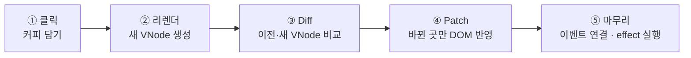

# Mini React

## 프로젝트 소개

브라우저 표준 API로 React의 핵심 동작을 직접 구현한 학습용 프로젝트

### Phase 1

- 실제 DOM을 VNode로 변환
- Diff와 Patch를 통한 두 VNode 트리의 차이 계산 및 실제 DOM 반영
- History를 통한 VNode 스냅샷 저장 및 이전·다음 화면 이동

### Phase 2

- 함수 컴포넌트와 상태 관리 구현
- `useState`·`useEffect`·`useMemo` 구현

## 데모: 정글 생존 자판기

mini-react로 만든 예시 앱

```bash
npm run dev
```

실행 후 `/vending/index.html` 접속

| 기능                 | 사용한 훅   | 확인 방법                                          |
| -------------------- | ----------- | -------------------------------------------------- |
| 아이템 담기·취소     | `useState`  | 영수증에 줄이 추가·삭제됨                          |
| 생존 점수 계산       | `useMemo`   | 영업 상태만 바꾸면 "점수 계산" 횟수가 늘지 않음    |
| 영업 중·휴식 중 전환 | `useState`  | 문구와 색이 바뀌고, 휴식 중에는 담기 버튼 비활성화 |
| 선택 내역 자동 저장  | `useEffect` | 새로고침해도 선택 내역이 남아 있음                 |

상태와 훅은 루트 컴포넌트 `App`에만 있고, 자식 컴포넌트는 props만 받는 순수 함수

## 전체 동작 흐름

### 상태 변경과 리렌더



### 예시: 자판기에서 커피 담기

수면이 담긴 상태(30점)에서 커피 담기를 한 번 눌렀을 때

| 단계     | 일어나는 일                                                                |
| -------- | -------------------------------------------------------------------------- |
| ① 클릭   | `setItems` 호출, 선택 목록 `[수면]` → `[수면, 커피]`, 리렌더 예약          |
| ② 리렌더 | `App`을 다시 실행해 새 VNode 트리 생성                                     |
| ③ Diff   | 영수증 한 줄 추가, 점수·합계·개수·렌더 횟수 텍스트, 막대 길이의 차이 발견  |
| ④ Patch  | 패치 목록에 있는 노드만 실제 DOM에 반영                                    |
| ⑤ 마무리 | 최신 이벤트 핸들러 연결, 선택 내역을 `localStorage`에 저장하는 effect 실행 |

### 패치 목록

③에서 Diff가 만드는 객체 배열. 위 예시에서 나오는 7개 중 3개

```js
[
  // 점수 텍스트 노드를 '40'으로 바꿔라
  { type: 'SET_DATA', path: [0, 1, 0, 1, 1, 1, 0], value: '40' },
  // 점수 막대의 style 속성을 바꿔라
  { type: 'UPDATE_ATTRS', path: [0, 1, 0, 1, 1, 2, 0], set: { style: 'width:40%' }, remove: [] },
  // 영수증 <ul>의 1번 자리에 커피 <li>를 넣어라
  {
    type: 'INSERT',
    parentPath: [0, 1, 1, 1, 1],
    index: 1,
    node: { type: 'element', tag: 'li' /* ... */ },
  },
];
```

- `path`: 대상 노드의 위치. 컨테이너에서 시작해 몇 번째 자식인지를 순서대로 적은 배열
- Diff는 이 배열을 만들기만 하고 DOM에 접근하지 않음. DOM 변경은 Patch에서만 수행

### `update()`

②~⑤를 실행하는 코드 (`src/component/FunctionComponent.js`)

```js
const nextVNode = this.render(); // 1
applyPatches(this.container, diff(this.vnode, nextVNode)); // 2
bindEvents(this.container.firstChild, nextVNode); // 3
this.vnode = nextVNode; // 4
this.runEffects(); // 5
```

| 줄  | 단계           | 하는 일                                                                                           |
| --- | -------------- | ------------------------------------------------------------------------------------------------- |
| 1   | ② 리렌더       | 컴포넌트 함수를 다시 실행해 새 VNode 트리 생성                                                    |
| 2   | ③ Diff ④ Patch | 이전 VNode와 새 VNode를 `diff`로 비교하고, 나온 패치 목록을 `applyPatches`로 실제 DOM에 적용      |
| 3   | ⑤ 이벤트 연결  | VNode의 `events`를 같은 위치의 DOM 요소에 연결                                                    |
| 4   |                | 새 VNode를 보관. 다음 업데이트에서 이것이 "이전 VNode"가 됨                                       |
| 5   | ⑤ effect 실행  | 실행 조건을 만족하는 effect 실행. DOM 반영이 끝난 뒤이므로 `localStorage` 저장이 이 시점에 일어남 |

①의 리렌더 예약은 `update()` 밖에서 처리: `setState`가 `scheduleUpdate()`를 호출하고, 연달아 호출해도 `update()`는 한 번만 실행

### 주요 용어

| 용어      | 뜻                                                                                                     |
| --------- | ------------------------------------------------------------------------------------------------------ |
| 실제 DOM  | 브라우저가 관리하는 노드 트리이자 패치 적용 대상                                                       |
| VNode     | DOM 구조를 객체로 표현한 가상 노드                                                                     |
| 리렌더    | 상태 변경 후 컴포넌트를 다시 실행해 새 VNode 트리를 만드는 과정                                        |
| Diff      | 이전·새 VNode 트리를 비교해 패치 목록을 만드는 순수 함수                                               |
| 패치 목록 | 차이를 실제 DOM에 반영하기 위한 변경 연산 목록 (`INSERT`·`REMOVE`·`REPLACE`·`SET_DATA`·`UPDATE_ATTRS`) |
| Patch     | 패치 목록을 실제 DOM에 적용하는 과정                                                                   |

## VNode 구조

- 요소·텍스트·주석으로 이루어진 DOM 구조를 객체로 표현
- `type`으로 노드 종류 구분
  - 요소 노드: 태그, 속성, 자식 배열 보관
  - 텍스트·주석 노드: 문자열 보관
- 이벤트 핸들러: 속성과 분리한 `events` 필드에 보관
  - `events` 필드는 직렬화 대상에서 제외
  - 저장할 DOM 구조 데이터와 실행할 이벤트 함수의 분리

자판기 영수증의 한 줄을 VNode로 표현한 예 (아이템 이름 `<span>`은 생략)

```js
{
  type: 'element',
  tag: 'li',
  attrs: {},
  children: [
    {
      type: 'element',
      tag: 'span',
      attrs: { class: 'plus' },
      // JSX의 `+{menu.score}`는 텍스트 노드 두 개가 된다
      children: [
        { type: 'text', text: '+' },
        { type: 'text', text: '10' },
      ],
    },
    {
      type: 'element',
      tag: 'button',
      attrs: { type: 'button', class: 'cancel' },
      events: { click: () => onRemove(item.entryId) }, // 함수는 attrs가 아니라 events에 따로 둔다
      children: [{ type: 'text', text: '취소' }],
    },
  ],
}
```

### History

Phase 1 검증 페이지(`/phase1/`)의 뒤로·앞으로 가기

- 함수가 없는 VNode는 순수 데이터이므로 스냅샷으로 그대로 저장
- 이전·다음 기록 이동 시 실제 DOM을 다시 VNode로 읽어 목표 스냅샷과 비교하고, 그 차이를 실제 DOM에 반영
- 과거 기록에서 새 변경 저장 시 이후 기록 삭제 및 새 기록 추가

## 훅의 역할

| 훅          | 역할                                                 | 자판기에서                               |
| ----------- | ---------------------------------------------------- | ---------------------------------------- |
| `useState`  | 리렌더 사이에 값을 기억하고, 값이 바뀌면 리렌더 예약 | 선택 목록, 영업 상태                     |
| `useMemo`   | 의존성이 그대로면 이전 계산 결과 재사용              | 선택 목록이 같으면 점수 계산 생략        |
| `useEffect` | DOM 반영이 끝난 뒤 실행, 의존성이 그대로면 생략      | 첫 렌더와 선택 목록이 바뀐 렌더에서 저장 |

### 예시: 영업 상태 전환

화면 아래 `렌더 N회 · 점수 계산 N회`로 확인

- 영업 상태는 선택 목록과 별개의 state
- 전환 시 컴포넌트 재실행으로 렌더 횟수 1 증가
- 선택 목록이 이전 렌더와 같아 점수 계산 횟수는 유지

```js
const score = useMemo(() => calculateScore(items), [items]);
```

### 예시: 새로고침

- 페이지가 처음부터 다시 실행되어 횟수는 1, 영업 상태는 초깃값으로 복귀
- 선택 내역은 유지
- 저장: 선택 목록이 바뀐 렌더의 DOM 반영 뒤 `useEffect`가 `localStorage`에 기록
- 복원: 첫 렌더에서 `useState`의 초기화 함수가 저장된 값을 읽어 초기 상태로 사용

```js
const [items, setItems] = useState(loadItems); // loadItems는 첫 렌더에만 실행

useEffect(() => {
  localStorage.setItem(STORAGE_KEY, JSON.stringify(items.map((item) => item.menuId)));
}, [items]);
```

## 이벤트 처리

### 문제

- 초기 앱 코드에서 `useEffect`로 버튼 탐색 및 이벤트 리스너 직접 연결
- 요소 탐색과 이벤트 연결·정리 코드의 반복

### 검토한 방식

| 방식                                                    | 장점                                           | 단점                                                      | 채택   |
| ------------------------------------------------------- | ---------------------------------------------- | --------------------------------------------------------- | ------ |
| 앱의 `useEffect`에서 `bindEvents` 호출                  | 이벤트 연결을 공통 함수로 통합                 | 앱별 호출 부담 및 호출 누락 가능성                        | 미채택 |
| 루트 이벤트 위임                                        | 루트에 리스너 집중                             | 대상 탐색 및 버블링하지 않는 이벤트 처리의 복잡성         | 미채택 |
| 요소별 리스너 유지 및 핸들러 교체                       | 고정 리스너를 통한 최신 핸들러 호출            | 검토한 설계 기준으로 이벤트용 패치 연산 및 명세 수정 필요 | 미채택 |
| 렌더 후 컴포넌트 계층에서 DOM 이벤트 속성에 핸들러 대입 | 앱의 요소 탐색·이벤트 연결·정리 코드 반복 제거 | 매 렌더마다 노드 순회 및 핸들러 재대입                    | 채택   |

### 선택

- 렌더 후 컴포넌트 계층에서 VNode와 실제 DOM을 함께 순회
- 각 DOM 요소의 이벤트 속성에 최신 핸들러 대입
- 앱에서는 이벤트 핸들러 선언, mini-react에서는 실제 연결 담당

### 이유

- 구현의 단순함
- 이벤트 연결을 위한 기존 Diff·Patch 및 명세 확장 불필요

## JSX 도입

### 문제

- 초기 앱 코드에서 VNode 객체 직접 작성
- DOM 구조가 복잡해질수록 객체와 자식 배열의 중첩 증가
- 중첩 구조에 따른 가독성 및 수정 편의성 저하

### 검토와 선택

- 객체 생성을 줄이는 헬퍼 함수 검토
- DOM 구조를 더 직관적으로 표현하기 위해 JSX 선택

같은 버튼을 두 방식으로 쓴 비교

```js
// VNode 객체 직접 작성
{
  type: 'element',
  tag: 'button',
  attrs: { type: 'button', class: 'cancel' },
  events: { click: () => onRemove(item.entryId) },
  children: [{ type: 'text', text: '취소' }],
}
```

```jsx
// JSX
<button type="button" className="cancel" onClick={() => onRemove(item.entryId)}>
  취소
</button>
```

### 변환 과정

```jsx
// 1. 작성한 JSX
<button className="cancel" onClick={handleRemove}>
  취소
</button>
```

```js
// 2. Vite가 변환한 결과: React.createElement가 아니라 우리 h() 호출
h('button', { className: 'cancel', onClick: handleRemove }, '취소');
```

```js
// 3. h()가 실행되어 만든 VNode
{
  type: 'element',
  tag: 'button',
  attrs: { class: 'cancel' }, // className → class
  events: { click: handleRemove }, // onClick → events.click (attrs에 함수를 넣지 않음)
  children: [{ type: 'text', text: '취소' }], // 문자열 → 텍스트 노드
}
```

- Vite 설정에서 JSX 변환 대상을 `h`로 지정 (`demo/vite.config.js`)
- 결과는 직접 작성한 VNode 객체와 같은 형태이므로 Diff·Patch는 JSX 사용 여부와 무관

### 적용 범위

- 데모 앱의 `.jsx` 파일에서만 JSX 사용
- React 런타임 미사용 (React를 import하지 않음)
- 핵심 구현인 `src/`는 JSX 없이 작성하여 변환 없이 브라우저의 ES Modules로 동작

## 한계와 실제 React와의 차이점

| 항목                  | mini-react                                                            | 실제 React                                |
| --------------------- | --------------------------------------------------------------------- | ----------------------------------------- |
| 리스트 비교           | 인덱스 순서로 1:1 비교. 맨 앞에 삽입하면 뒤 항목이 모두 변경으로 판정 | `key`로 이동을 인식하고 기존 DOM 재사용   |
| `useEffect` 실행 시점 | DOM 반영 직후 동기 실행 (`useLayoutEffect`에 가까움)                  | 브라우저가 화면을 그린 뒤 실행            |
| 이벤트                | DOM 이벤트 속성에 핸들러 직접 대입                                    | 루트에서 이벤트 위임과 합성 이벤트로 처리 |

## 개발 및 검증 과정

### AI 활용

- LMS 키워드를 바탕으로 개념 학습
- AI 설명과 질의응답을 통한 이해 보완
- 요구사항 정리 후 구현 대안 비교 및 모듈별 구현
- 모델 A로 각각 구현한 결과물을 모델 B로 병합
- 코드 독해 중 이해되지 않는 문법·로직·설계 의도 질문

### 검증 활동

- 테스트 코드 선작성 방식으로 동작 확인
- 데모 직접 사용 중 export 누락과 이벤트 미연결 문제 발견
- 모델 B의 병합은 구현 결과 통합 단계로 구분
- 병합 과정의 검증 내용 불명확으로 별도의 2차 검증 여부 미확인

### 확인 필요 사항

> 발표 전에 확인한 결과로 바꿔 적거나 이 섹션을 지울 것

- 모델 B로 병합한 뒤 테스트 재실행 여부
- 발견한 export 누락과 이벤트 미연결 문제의 수정 여부
- 문제 수정 후 데모 동작 재확인 여부
